A Small Attribution Walkthrough
===============================

This companion to [How Attribution Works](attribution.md) follows one small job from raw observations to an `AttributionResult`. It uses the bundled rules and shows only the fields that affect this example.

## The case

| Job field | Value |
|---|---|
| Job ID | `walkthrough-42` |
| State | `FAILED` |
| Nodes | `node-01` |
| Observation window | `2025-04-15T16:26:40Z`–`16:28:20Z` |

The client supplies two observations and then requests attribution:

```python
attributor.ingest(syslog_observation)
attributor.ingest(metrics_observation)
result = attributor.attribute()
```

<div align="center">



</div>

```mermaid
flowchart LR
    accTitle: Worked attribution example
    accDescr: Two observations produce three events. Filtering leaves the events unchanged, refinement selects one root-cause symptom, optional collection is skipped, and attribution returns a Fail InfraSW result.

    O["Two observations<br/>three source records"]
    E["Extraction<br/>two bad events<br/>one interesting event"]
    F["Filtering<br/>no change"]
    R["Refinement<br/>one root cause"]
    C["Collection<br/>disabled"]
    A["AttributionResult<br/>Fail InfraSW"]

    O --> E --> F --> R --> C --> A

    classDef input fill:#f6f8fa,stroke:#57606a,color:#24292f,stroke-width:1.5px
    classDef extraction fill:#dcecff,stroke:#3b6fb6,color:#24292f,stroke-width:2px
    classDef filtering fill:#fff0cc,stroke:#a86614,color:#24292f,stroke-width:2px
    classDef refinement fill:#ede3ff,stroke:#805ad5,color:#24292f,stroke-width:2px
    classDef collection fill:#e7eef3,stroke:#526d82,color:#24292f,stroke-width:2px
    classDef result fill:#ddf5ee,stroke:#2f855a,color:#24292f,stroke-width:2px

    class O input
    class E extraction
    class F filtering
    class R refinement
    class C collection
    class A result
```

## Observations

Each observation also has a context containing the job's time window, source, format, resources, and timezone. The listings below are their complete `lines` values.

### System log

Source `SYSLOG`, format `RAW_LOKI_STREAMS`:

```json
[
  {
    "stream": { "node_name": "node-01" },
    "values": [
      [
        "1744734450000000000",
        "Unable to handle kernel NULL pointer dereference at virtual address 0000000000000008"
      ],
      [
        "1744734451000000000",
        "Internal error: Oops: 0000000096000007 [#1] SMP"
      ]
    ]
  }
]
```

### Node metric

Source `NODE_METRICS`, format `PROMETHEUS_METRICS`:

```json
[
  {
    "timestamp": 1744734452,
    "metric": "ib_roce_adp_retrans",
    "value": "51",
    "labels": {
      "net_host_name": "node-01",
      "device": "mlx5_0",
      "s_cluster": "test-cluster"
    },
    "node": "node-01",
    "component": "mlx5_0",
    "cluster": "test-cluster"
  }
]
```

## Ingestion and extraction

Each `ingest()` call registers the observation context and runs the extractors for that source. The three source records produce three active events:

| Matched input | Extractor | Emits | Symptom |
|---|---|---|---|
| `Unable to handle kernel …` | `SyslogKernelInvalidMemoryAccess` | bad | `kernel invalid memory access` |
| `Internal error: Oops …` | `SyslogKernelOops` | bad | `kernel oops` |
| `ib_roce_adp_retrans = 51` | `NodeMetrics_roce_adp_retrans` | interesting | `performance_roce_adp_retrans_high` |

The metric rule fires because `51 > 50`. It deliberately emits an interesting event: the elevated retransmit count is useful evidence, but is not by itself treated as a failure.

Every event retains the source record, timestamp, observation context, originating rule, and node. Its payload is small; for example:

```json
{
  "event_type": "Attribution.node.bad",
  "source_rule": "kernel-invalid-memory-access",
  "payload": {
    "node": "node-01",
    "symptom": "kernel invalid memory access"
  }
}
```

## Filtering and materialization

Filtering runs over the complete event stream when `attribute()` begins. No filter rule applies to this combination, so all three events remain active.

The active attribution events are then grouped by node. Their event types determine whether their sources enter the bad or interesting side of the node attribution:

| Node | Bad symptoms | Interesting symptoms |
|---|---|---|
| `node-01` | `kernel invalid memory access`<br/>`kernel oops` | `performance_roce_adp_retrans_high` |

This separation matters: only bad symptoms are aggregated into the job-level symptom set used to choose an outcome. Interesting evidence remains available for diagnosis and reporting.

## Refinement and outcome selection

The state changes are small enough to show as a ledger:

| Point | Outcome-driving symptoms | What changed |
|---|---|---|
| After materialization | `kernel invalid memory access`<br/>`kernel oops` | The retransmit metric is already separate, interesting evidence. |
| After `SCRUB` | `kernel invalid memory access`<br/>`kernel oops` | No node-level scrub rule applies. |
| After `FINAL` | `kernel invalid memory access`<br/>`job failed` | DAG pruning demotes the generic oops to interesting. The `FAILED` scheduler state contributes `job failed`. |
| Outcome mapping | same | `kernel invalid memory access` maps to `Fail InfraSW` and outranks the generic scheduler symptom. |
| After `POST_OUTCOME` | `kernel invalid memory access` | The weaker `job failed` symptom is removed now that a specific cause is known. |

In this path, the pruned node symptom is demoted to interesting evidence rather than erased. The original oops line therefore remains attached to `node-01`, even though it no longer participates in the outcome.

## Result

With collectors left at their default of disabled, the important result fields are equivalent to:

```yaml
outcome: Fail InfraSW
root_cause_symptom: kernel invalid memory access
hw_cause: Not Applicable
symptoms:
  - kernel invalid memory access
nodes:
  node-01:
    bad:
      - kernel invalid memory access
    interesting:
      - kernel oops
      - performance_roce_adp_retrans_high
collectors: {}
```

This is a compact projection of `AttributionResult`, not its literal serialized form. Each listed symptom still carries its source set, allowing the caller to trace the result back to the raw log line or metric record.

Finally, `attribute()` performs its work against a checkpoint and restores the extracted event stream before returning. A later attribution can therefore reconsider the same evidence—possibly together with newly ingested observations—without reusing the mutations from this run.
